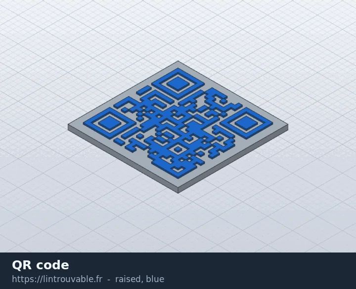

# Code Maker plugin for SolidCraft


A [SolidCraft](https://github.com/tangency-labs/solidcraft) plugin that puts a QR code, another 2D code or barcode
(Data Matrix, Aztec, PDF417, Code 128, EAN-13 and more), an
[ArUco](https://docs.opencv.org/4.x/d5/dae/tutorial_aruco_detection.html) marker or an
[AprilTag](https://github.com/AprilRobotics/apriltag) (the fiducial markers cameras and robots track) on a new plate or on a
face of your model, raised or engraved, ready for 3D printing.

<p align="center"></p>

The demo shows real results of the plugin in SolidCraft: one plate for each type of code, made by the plugin itself and
photographed with `solidcraft-cli snapshot`.

## Install

1. Download `code-maker-<version>.zip` from the [Releases](../../releases) page.
2. In SolidCraft, open **Preferences > Plugins > Install plugin…**, pick the zip and accept the permissions.
   The plugin needs no files and no network.
3. Click **Code** in the **Plugins** group of the Model tab.

## Use

1. Choose the type of code. For a QR code or a barcode, type a text, a link or a number. For an ArUco marker or an AprilTag,
   choose its family and give the marker number.
2. Optional: click a flat face of your model. Without a face you get a new plate.
3. Choose raised or engraved, a colour, a size, and run.

| Field | Default | Meaning |
|---|---|---|
| Type of code | QR code | QR code, another 2D code, a barcode, an ArUco marker or an AprilTag; the form then shows only the fields of that type |
| Error correction | Medium (15%) | QR code only: Low (7%), Medium (15%), Quartile (25%) or High (30%). More reads through more damage or dirt, in a denser code, so its modules are smaller for the same size |
| Text or link, or the number of a barcode | `https://example.com` | What the code says (at most 500 characters), in the field of its type; not used for a marker |
| Marker number | 0 | ArUco or AprilTag only: the marker's number in its dictionary |
| Put it on a face | none | A flat face of your model; empty gives a new plate |
| Style | Raised | Raised from the surface, engraved into it, or inlay: engraved and filled flush by a body of its own |
| Code as its own body | Off | Makes a raised code a body of its own, not part of the plate or face, so a slicer can print it in another filament. An inlay always is |
| Colour of the code | Black | Colour of the raised modules or of the engraving; No colour keeps the colour of the part |
| Size | 30 mm for a QR code, more for a barcode | Width of the code (the whole barcode, for a barcode). The form starts at a size that suits the type (65 mm for an EAN-13, 80 mm for a Code 128, ...). Smaller than the code can print (modules under 0.4 mm) and it is raised to the least that works; the result says so |
| Bar height | 15 mm | Barcodes only: how tall the bars are |
| Height or depth | 0.6 mm | How far it stands out, or how deep it is cut |
| Move X / Y / Z | 0 mm | Moves the code (the new plate, or the code on a face) |
| Move along | World axes | With a face: the world axes, or the face's own (X right, Y up, Z out of the face), to lift or sink the code on a slanted or vertical face |
| Rotate | 0° | Turns the code on its face, counter-clockwise (needs a face; refused without one) |

### Codes and barcodes

Each type with strict rules has its own field in the form, with the rule and an example that works as it is. A mistake is
shown on that field and says what is wrong, for example `the check digit should be 7, not 3`.

| Type | Field | What it takes |
|---|---|---|
| QR code, Data Matrix, Aztec, PDF417 | Text or link | any text, at most 500 characters |
| Code 128 | Code 128 text | plain ASCII text (`ABC-123456`); the longer it is, the wider the barcode |
| EAN-13 | EAN-13 number | 12 or 13 digits (`5901234123457`). With 12 the check digit is added; with 13 the last one must be right |
| EAN-8 | EAN-8 number | 7 or 8 digits (`96385074`), same rule |
| UPC-A | UPC-A number | 11 or 12 digits (`036000291452`), same rule |
| UPC-E | UPC-E number | 7 or 8 digits starting with 0 or 1 (`01234565`) |
| ITF | ITF number | digits only, an even number of them (add a 0 in front if odd) |
| Code 39, Code 93 | Code 39 / 93 text | capital letters, digits, space and `- . $ / + %` (`ABC-1234`) |
| Codabar | Codabar text | digits and `- $ : / . +` between a start and a stop letter A to D (`A12345B`) |

Spaces and hyphens in a number are ignored (`5 901234 123457` works). A barcode is wide, so its **Size** is its width: a barcode needs
more than 30 mm, and the form starts at a size that suits each type. If you go lower, the size is raised to the least that prints well (modules of 0.4 mm) and the result says so, instead of refusing. Barcodes read best as
dark bars on a light plate. `scripts/verify-barcodes.py` reads every barcode back with the ZXing reader.

### ArUco markers and AprilTags

A marker is drawn from the official dictionaries, so a detector reads it back as the number you chose. The picture is
the one the dictionary's own tools draw: the marker's bits inside a black border, dark modules raised (or engraved) and
the rest left as the plate. **Size** is the width of the marker including its black border, and a new plate adds a white
margin around it.

| Family in the form | Markers |
|---|---|
| ArUco 4x4 (`4x4_50`), 5x5 (`5x5_100`), 6x6 (`6x6_250`) | 50, 100, 250 |
| ArUco original | 1024 |
| AprilTag 36h11 (the usual one) | 587 |
| AprilTag 16h5 | 30 |
| AprilTag Standard 41h12 | 2115 |

An id past the end of the dictionary, or a dictionary of the other kind, is refused with a message that says what is valid.
`scripts/verify-tags.py` checks every dictionary against OpenCV's ArUco detector and the AprilTag library.

Good to know:

- The code is centred on the picked face and stays upright. A code larger than the face overhangs it.
- Only flat faces work, such as the top of a cylinder. A curved face (the side of a cylinder) is refused with "the face is not flat".
- A new plate is 2 mm thick with a small blank border. The whole result is one body, unless the code is its own body (an inlay, or **Code as its own body**): then the plate and the code are two bodies, the code named `QR code` and coloured as asked, and the plate keeps its own colour.
- Run it again in the same design and the new code is named `QR code 2`, `QR code 3`, and so on. A new plate with no move asked goes 5 mm to the right of what the design already holds.
- The code is a sketch plus an extrusion, so you can edit it afterwards in the timeline. The colour is set once when the code is made: if you change the height or the sketch later, colour the new faces with the Appearance command.
- One run is one undo step. A wrong input changes nothing.
- A very long text is refused (about 100 characters of link): each outline of the code is one SolidCraft call, and a run may last at most 30 s.
- Too small a size for the text (a module under 0.4 mm) is refused, and the message says the size needed.

From a script or an MCP client the entry is `code-maker.code`. SolidCraft's MCP server exposes it as the tool `code-maker_code`: call that tool directly (a generic `execute` of `code-maker.code` asks for a plugin approval token first), with `kind` (`qr`, `datamatrix`, `aztec`, `pdf417`, `code128`, `code39`, `code93`, `ean13`, `ean8`, `upca`, `upce`, `itf`, `codabar`, `aruco` or `apriltag`), `qr_correction` (`low`, `medium`, `quartile` or `high`, QR code), `text` (QR code, 2D code or Code 128) or `<kind>_text` (`ean13_text`, `upca_text`, `code39_text`, ... for the strict barcodes), `bar_height` (barcode), `aruco_dictionary` or `apriltag_dictionary` and `id` (marker), `face` (a pick of a body's face by `index`, `name` or a `point` on it), `style` (`raised`, `engraved` or `inlay`), `own_body` (`true` makes a raised code a body of its own; an inlay always is),
`color` (`black`, `blue`, `red`, `green`, `orange`, `yellow`, `white` or `none`), `size`, `height`, `move_x`,
`move_y`, `move_z`, `move_axes` (`world` or `face`) and `rotation`.

## How it works

Every QR code, 2D code and barcode comes from the [`rxing`](https://crates.io/crates/rxing) crate, used for its writers
only (a QR code with the error correction you choose). The ArUco and AprilTag pictures
come from the official dictionaries, kept in `code-maker-src/src/tags.rs` (made by `scripts/gen-tags.py`). The plugin traces the outline of
every dark region and draws them in one sketch, then extrudes the dark regions only. The colour is put on the faces
that the code adds, never on the rest of the part.

## Build

You need Rust with the `wasm32-unknown-unknown` target and `wasm-tools`:

```sh
rustup target add wasm32-unknown-unknown
cargo install wasm-tools
scripts/package.sh        # writes dist/code-maker-<version>.zip
solidcraft-cli plugin check code-maker
solidcraft-cli plugin test code-maker
```

`code-maker/` is the package (manifest, icon, tests and the built component), `code-maker-src/` is the Rust crate.

## Releases

The changes of each version are in the [changelog](CHANGELOG.md); the release notes are taken from it.

CI builds the zip on every push and pull request. A separate security workflow runs gitleaks (secrets), `cargo audit` and a dependency review (vulnerable dependencies) and actionlint (workflow files) on pushes, pull requests and every Monday, and Dependabot proposes weekly updates. Pushing a tag such as `v0.5.0` publishes a release with the zip and
its checksum. The tag must match the `version` in `code-maker/plugin.json` and `code-maker-src/Cargo.toml`.

## Licence

[MIT](LICENSE). The plugin includes [`rxing`](https://github.com/rxing-core/rxing) (Apache-2.0), a port of ZXing, which
makes the QR codes, the other 2D codes and the barcodes. The ArUco dictionaries come from [OpenCV](https://github.com/opencv/opencv) (Apache-2.0) and the
AprilTag families from [AprilRobotics/apriltag](https://github.com/AprilRobotics/apriltag) (BSD-2-Clause, Copyright
2013-2016 The Regents of The University of Michigan); their licence terms apply to that data.
