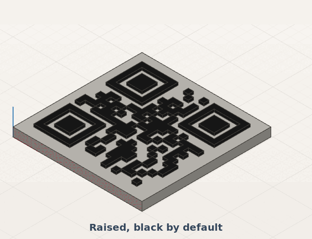

# Code Maker plugin for SolidCraft


A [SolidCraft](https://github.com/tangency-labs/solidcraft) plugin that puts a QR code on a new plate or on a
face of your model, raised or engraved, ready for 3D printing.

<p align="center"></p>

The demo shows real results of the plugin in SolidCraft.

## Install

1. Download `code-maker-<version>.zip` from the [Releases](../../releases) page.
2. In SolidCraft, open **Preferences > Plugins > Install plugin…**, pick the zip and accept the permissions.
   The plugin needs no files and no network.
3. Click **Code** in the **Plugins** group of the Model tab.

## Use

1. Type a text or a link.
2. Optional: click a flat face of your model. Without a face you get a new plate.
3. Choose raised or engraved, a colour, a size, and run.

| Field | Default | Meaning |
|---|---|---|
| Text or link | `https://example.com` | What the code says (at most 500 characters) |
| Put it on a face | none | A flat face of your model; empty gives a new plate |
| Style | Raised | Raised from the surface, or engraved into it |
| Colour of the code | Black | Colour of the raised modules or of the engraving; No colour keeps the colour of the part |
| Size | 30 mm | Width of the code |
| Height or depth | 0.6 mm | How far it stands out, or how deep it is cut |
| Move X / Y / Z | 0 mm | Moves the code (the new plate, or the code on a face) |
| Move along | World axes | With a face: the world axes, or the face's own (X right, Y up, Z out of the face), to lift or sink the code on a slanted or vertical face |
| Rotate | 0° | Turns the code on its face, counter-clockwise (needs a face; refused without one) |

Good to know:

- The code is centred on the picked face and stays upright. A code larger than the face overhangs it.
- Only flat faces work, such as the top of a cylinder. A curved face (the side of a cylinder) is refused with "the face is not flat".
- A new plate is 2 mm thick with a small blank border. The whole result is one body.
- Run it again in the same design and the new code is named `QR code 2`, `QR code 3`, and so on. A new plate with no move asked goes 5 mm to the right of what the design already holds.
- The code is a sketch plus an extrusion, so you can edit it afterwards in the timeline. The colour is set once when the code is made: if you change the height or the sketch later, colour the new faces with the Appearance command.
- One run is one undo step. A wrong input changes nothing.
- A very long text is refused (about 100 characters of link): each outline of the code is one SolidCraft call, and a run may last at most 30 s.
- Too small a size for the text (a module under 0.4 mm) is refused, and the message says the size needed.

From a script or an MCP client the entry is `code-maker.code`. SolidCraft's MCP server exposes it as the tool `code-maker_code`: call that tool directly (a generic `execute` of `code-maker.code` asks for a plugin approval token first), with `text`, `face` (a pick of a body's face by `index`, `name` or a `point` on it), `style` (`raised` or `engraved`),
`color` (`black`, `blue`, `red`, `green`, `orange`, `yellow`, `white` or `none`), `size`, `height`, `move_x`,
`move_y`, `move_z`, `move_axes` (`world` or `face`) and `rotation`.

## How it works

The QR matrix comes from the [`qrcodegen`](https://crates.io/crates/qrcodegen) crate. The plugin traces the outline of
every dark region and draws them in one sketch, then extrudes the dark regions only. The colour is put on the faces
that the code adds, never on the rest of the part.

## Build

You need Rust with the `wasm32-unknown-unknown` target and `wasm-tools`:

```sh
rustup target add wasm32-unknown-unknown
cargo install wasm-tools
scripts/package.sh        # writes dist/code-maker-<version>.zip
solidcraft-cli plugin check code-maker
solidcraft-cli plugin test code-maker
```

`code-maker/` is the package (manifest, icon, tests and the built component), `code-maker-src/` is the Rust crate.

## Releases

The changes of each version are in the [changelog](CHANGELOG.md); the release notes are taken from it.

CI builds the zip on every push and pull request. A separate security workflow runs gitleaks (secrets), `cargo audit` and a dependency review (vulnerable dependencies) and actionlint (workflow files) on pushes, pull requests and every Monday, and Dependabot proposes weekly updates. Pushing a tag such as `v0.5.0` publishes a release with the zip and
its checksum. The tag must match the `version` in `code-maker/plugin.json` and `code-maker-src/Cargo.toml`.

## Licence

[MIT](LICENSE). The plugin includes [`qrcodegen`](https://crates.io/crates/qrcodegen) (MIT, Project Nayuki), which
makes the QR matrix.
